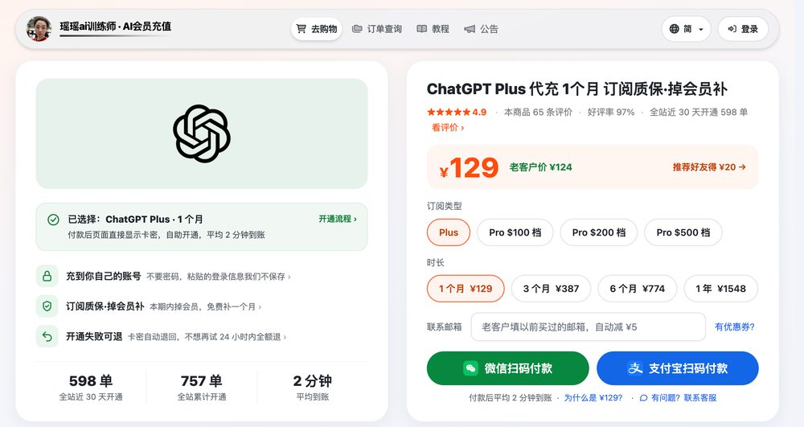
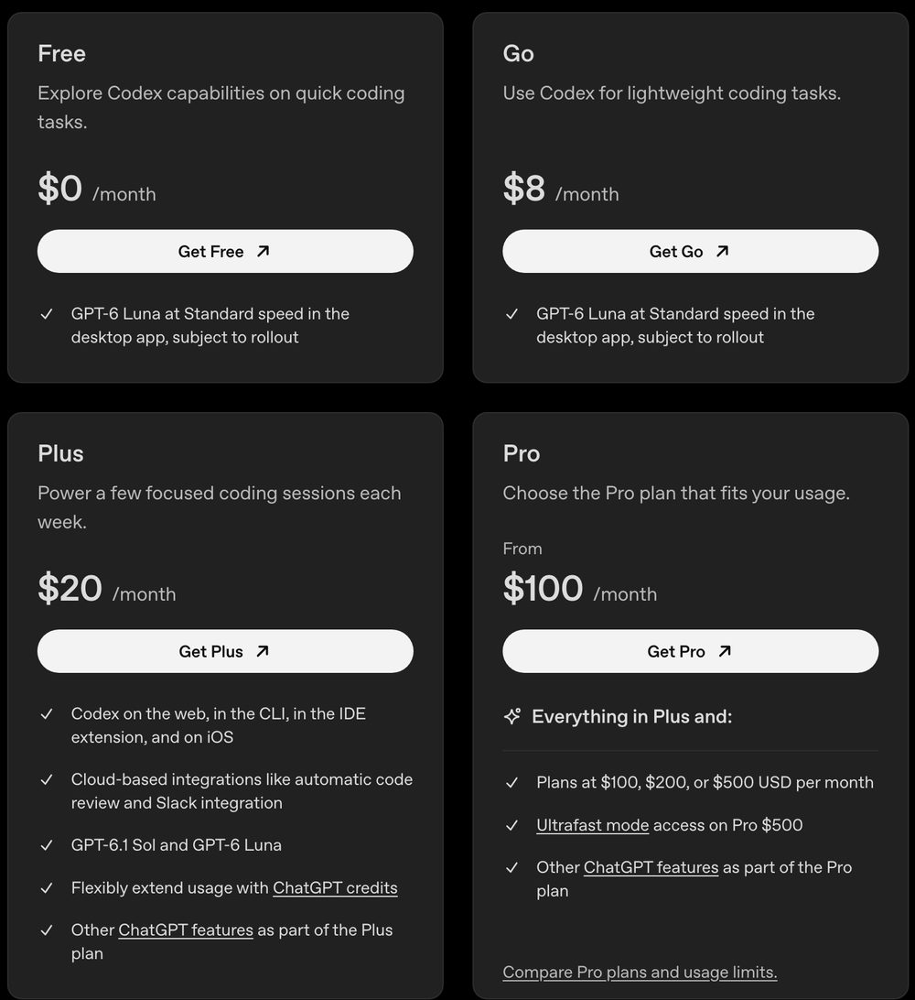

# ChatGPT共享账号 2026：合租靠谱吗、会不会封、自己开 Plus 怎么选

> 2026-11-19 更新

**先说结论：** 想找 ChatGPT共享账号、和人合租省钱的，先想清楚一件事：官方条款不允许把账号给别人用，合租号里你问过的每句话，同车的人都能翻到。瑶瑶ai训练师的建议是一人一号，自己用就在瑶瑶的商城开 [ChatGPT Plus 一个月 ¥129](https://kw.yaoyao.chat/item/5?utm_source=github&utm_medium=readme&utm_campaign=gongxiang&utm_content=top)，充在你自己的号上，不交密码，支付宝、微信付，平均 2 分钟到账，开不成退钱。下单填券码 **888888** 再减 ¥3。

- **chatgpt合租便宜在哪**：几个人摊一份会员费。省下的是钱，搭进去的是隐私、额度和账号安全。
- **会不会封**：OpenAI 写明账号共享属于可能被永久关闭的情形之一，合租号一出事，整车人一起没。
- **自己开要多少**：官方 Plus 每月 20 美元；瑶瑶店里 ¥129 一个月，3 个月 ¥387，按月数乘。
- **谁不用买**：一周只问几句的，免费版就够；家里有人能在官网绑卡订阅、人也在支持地区的，各自官网开更直接。

*图：一个人开一份，瑶瑶商城 Plus 下单区就长这样，¥129 一个月起（来源 kw.yaoyao.chat/item/5，11 月 10 日截）*

## ChatGPT共享账号到底是哪几种

网上叫"共享""合租""拼车"的，其实是三样东西，风险不一样，先对号入座：

| 叫法 | 实际是什么 | 你拿到的 |
|---|---|---|
| 共享账号密码 | 卖家把一个号的邮箱密码发给好几个人，大家登同一个号 | 别人账号的使用权，不是你的会员 |
| 镜像站、"车队"网站 | 第三方网页套了个聊天框，后台接的是别人的号或接口 | 连 chatgpt.com 都没登，记录在对方服务器上 |
| 拉进工作区 | 卖家把你拉进他管的 Business 工作区当成员 | 管理员说了算，随时能把你移出去 |

三种有一个共同点：会员不在你名下。哪天卖家不干了、改了密码、号被关，你手里什么都不剩，聊天记录也带不走。kw 教程页那篇 [ChatGPT 会员能几个人共享](https://kw.yaoyao.chat/guide/chatgpt-gongxiang.html?utm_source=github&utm_medium=readme&utm_campaign=gongxiang&utm_content=guide) 把这三种的区别列得更细。

## 官方怎么说：一个号只给一个人用

这件事不用猜，OpenAI 写得很直白，2026-11-10 逐条对过：

- **使用条款**（中文版，2026 年 1 月 1 日生效）：不得分享账户凭据或让其他人使用你的账户，账户下发生的所有活动由你负责。
- **帮助中心《OpenAI Account Sharing Policy》**：账号是给创建它的那个人用的，别人要用就自己注册一个；同一个人在手机、电脑、平板上登录没问题，但用量限制会按账号活动和套餐算。
- **帮助中心《OpenAI account closures and safety suspensions》**：违反条款可能被永久关闭的例子里，明确列了"以违反条款的方式共享账号或 API Key"。
- **定价页常见问题**：免费版、Go、Plus 都是为个人使用设计的，多人一起用的是 Business，2 位用户起订。

说白了，合租不是"灰色地带"，是条款里点了名的事。你自己多设备登录不算共享，几个人分一个号才算。

## 合租和自己开 Plus：把账算清楚

很多人找合租，是觉得 ¥129 一个月有点贵。这个账值得细算一下，不光算钱。

官方 Plus 每月 20 美元。合租最常见的是三四个人分一个号，按官方价摊下来每人每月 5～7 美元左右，确实便宜一截。但你要接受下面这些代价：

| 对比 | 合租一个号 | 自己开 Plus |
|---|---|---|
| 价格 | 摊下来便宜 | 瑶瑶店里 ¥129 一个月 |
| 聊天记录 | 同车的人都能看到 | 只有你自己 |
| 额度 | 几个人抢同一份，高峰时最先见底 | 一个人用完整的一份 |
| 记忆和个性化 | 别人的习惯混进来，回答越来越不像给你写的 | 只记你自己的偏好 |
| 账号归属 | 卖家的，随时改密码 | 你的，到期不续也还在 |
| 被封的后果 | 一人违规，全车一起停 | 只和你自己的用法有关 |
| 售后 | 基本找不到人 | 开不成退钱，本期内掉会员补一个月 |

额度这块容易被忽略。Plus 的思考档、深度研究、Codex 都有用量上限，帮助中心也写了高峰期会有消息上限。一个人用通常够，四个人轮着用，最先撞顶的往往就是你最急的那天。

还有一笔隐形账：合租号常见的来路是低价渠道开的会员，比如付款被撤销的单子，这类号随时可能被收回。价格低得离谱的，先问一句"凭什么这么便宜"。

想看合租和其他开法放在一起比，kw 有一篇 [ChatGPT 合租和代充怎么选](https://kw.yaoyao.chat/guide/chatgpt-hezu.html?utm_source=github&utm_medium=readme&utm_campaign=gongxiang&utm_content=guide)；只想知道一个人开 Plus 怎么最省，看 [ChatGPT Plus 怎么买最划算](https://kw.yaoyao.chat/guide/plus-zuihuasuan.html?utm_source=github&utm_medium=readme&utm_campaign=gongxiang&utm_content=guide)。

*图：OpenAI 官方 Codex 定价页套餐卡片，Plus 每月 20 美元、Go 8 美元（截自 OpenAI 的 learn 文档站定价页，11 月 10 日）*

## 合租号的聊天记录，别人能不能看到

这是合租最常被问、也最少有人讲透的一点。答案是：**能，而且比你想的多。**

**为什么能看到。** 合租是几个人登录同一个账号。ChatGPT 的聊天记录、项目、上传过的文件、记忆，都挂在账号上，不分"谁打的字"。你在手机上问完，同车的人在电脑上刷新一下侧边栏，就能看到这段对话，点开就是全文。

**删了也不保险。** 你问完马上删，别人如果恰好开着页面，或者在你删之前点开过，内容已经看到了。更麻烦的是"记忆"：ChatGPT 会从对话里记下你的工作、家人、习惯，删掉对话不等于清掉已经记住的内容，下一个人提问时，回答里可能就带出你的信息。

**锁定聊天解决不了合租。** 2026 年 10 月起 ChatGPT 分批推出锁定聊天，可以用 4 位账号 PIN 把几段对话藏起来。但 PIN 绑在账号上，合租的人登的是同一个账号，谁知道 PIN 谁就能开；而且官方写明它不是加密，能打开的人照样能复制内容。它是防家里人顺手翻电脑的，不是给几个陌生人共用一个号设计的。细节见 [ChatGPT 锁定聊天怎么用](https://kw.yaoyao.chat/guide/chatgpt-suoding-liaotian.html?utm_source=github&utm_medium=readme&utm_campaign=gongxiang&utm_content=guide)。

**临时聊天也一样。** 临时聊天不进记录、不产生记忆，算是合租里相对干净的用法，但前提是每个人每次都记得开。只要有一次忘了，就进了公共记录。

**已经在合租的，怎么止损：**

1. 别在合租号里聊工作资料、身份证号、病情、家庭住址这类内容，更别贴任何密码。
2. 到设置里看一眼"记忆"，把跟你有关的条目删掉。
3. 重要对话自己另存，别指望号一直在。
4. 尽快换回自己的账号，哪怕先用免费版。

## 会不会封：合租号最容易出事的地方

帮助中心列的账号被关原因里，跟合租直接相关的有两条：一是以违反条款的方式共享账号；二是安全原因，系统发现像是别人在登录你的账号时，会限制访问。

合租号天然就长得像"被别人登录"：同一时间几个城市、几台陌生设备在用，登录环境来回跳。官方没有公开具体风控规则，但这种用法本身就踩在条款上，被要求验证、被停用都不奇怪。

封了之后，号主可以按停用邮件申诉，能不能恢复看官方审核，你作为"同车的人"连申诉的资格都没有。号上的聊天记录也就跟着没了。官方给的申诉入口只对账号本人开放，写在帮助中心那篇 closures 说明的最后一节。

## 不合租，几个人想一起用怎么办

**家里两三个人。** 每人注册一个自己的号。用得多的开 Plus，用得少的先用免费版，免费版日常文字聊天不限次数，只是工具和高级模型有限额。

**一台手机两个人用。** 官方 10 月底在手机 App 上推了账号切换，最多同时登录 2 个账号，各自的聊天、记忆、设置和订阅互不相干。一个号开 Plus、一个号免费，切来切去就行，玩法见 [ChatGPT 双账号切换](https://kw.yaoyao.chat/guide/chatgpt-qiehuan-zhanghao.html?utm_source=github&utm_medium=readme&utm_campaign=gongxiang&utm_content=guide)。

**只是想给朋友看一段回答。** 用对话里的"分享"生成链接。帮助中心写明，分享链接不会把账号权限给对方，对方只能看到你分享时的那部分内容，之后你再聊的不会自动带过去。

**公司或团队。** 走官方 ChatGPT Business，按人数开席位，每人一个账号，互相看不到对话。价格以官网为准。

## 自己开 Plus：在瑶瑶店里怎么开

如果你决定不合租了，自己开一个，流程很短：

1. 在商城下单 Plus 一个月，支付宝或微信付款，付完页面直接显示卡密。
2. 打开充值页 cz.yaoyao.chat，按提示复制一段开通用的登录信息（不是密码），连同卡密一起提交。
3. 平均 2 分钟，账号就变成 Plus。会员开在你原来的号上，聊天记录都在。

几个容易卡的地方：复制完登录信息别拖太久再提交，放久了会过期，最稳的是开无痕窗口重新登录、复制完马上交；在微信里打开链接复制，经常复制不全，换手机自带浏览器；账号上还有没到期的 Plus 时提交，会提示"已有订阅"，这次卡密不扣，等到期再用同一张。开通后到设置的安全里退出所有设备，那段登录信息就作废了，原因见 [复制的登录信息会不会被保存](https://kw.yaoyao.chat/guide/denglu-xinxi-anquan.html?utm_source=github&utm_medium=readme&utm_campaign=gongxiang&utm_content=guide)。

想一次多开几个月，可以下 [ChatGPT Plus 3 个月 ¥387](https://kw.yaoyao.chat/item/5?d=3&utm_source=github&utm_medium=readme&utm_campaign=gongxiang&utm_content=mid)，一单 3 张卡密，每张 1 个月，到期再充下一张。Plus 具体包含哪些功能，文末相关教程第一篇有完整对比表。

店里的规矩照实说：没开成，卡密自动退回能重提，不想再试就把订单号发到企业微信，24 小时内原路退回；本期内掉会员，凭订单号和截图再补一个月；账号被封或停用不在质保范围、不退款，ChatGPT 封号可协助重新注册一个账号。全部规则在 [瑶瑶ai训练师靠谱吗、售后怎么处理](https://kw.yaoyao.chat/guide/yaoyao-kaopu.html?utm_source=github&utm_medium=readme&utm_campaign=gongxiang&utm_content=guide)。

## 常见问题

**问：ChatGPT共享账号会被封吗？**
有可能。官方条款不许把账号给别人用，帮助中心（[Account Sharing Policy](https://help.openai.com/articles/10471989)）把"以违反条款的方式共享账号"列为可能永久关闭账号的情形。多人异地同时登录也容易触发安全限制。

**问：chatgpt合租一个月能省多少？**
按官方 20 美元、四个人分摊算，每人每月 5 美元上下。省下的钱换来的是聊天记录公开、额度被分、号随时可能没，自己掂量值不值。

**问：自己的 Plus 能在手机和电脑上同时用吗？**
能。官方限制的是把账号给别人，不是你自己多设备登录，同一个人手机、电脑、平板都可以登。

**问：合租号里删掉的聊天，别人还能看到吗？**
删之前别人点开过就已经看到了；记忆里记下的内容也不会因为删对话自动清掉。要聊私事，别用合租号。

**问：情侣或家人能共用一个 Plus 吗？**
条款上同样不允许，体验上也互相串记录、抢额度。各注册一个号，一个开 Plus、一个先用免费版，手机上用账号切换来回换。

**问：不想合租，又觉得 ¥129 贵，有没有更便宜的？**
官方还有 Go，每月 8 美元，额度比免费版高，但高级推理和深度研究跟 Plus 比差得多，瑶瑶店里也不卖 Go。用得少就先用免费版，真天天用再开 Plus，判断方法见 [普通人有必要买 ChatGPT Plus 吗](https://kw.yaoyao.chat/guide/chatgpt-plus-youbiyao.html?utm_source=github&utm_medium=readme&utm_campaign=gongxiang&utm_content=guide)。

**问：国内自己开 Plus 能用支付宝吗？**
官网不收支付宝和微信。瑶瑶店里收，付的是代充费，会员开在你自己的号上，见 [国内开 ChatGPT 会员能不能付支付宝](https://kw.yaoyao.chat/guide/chatgpt-zhifubao.html?utm_source=github&utm_medium=readme&utm_campaign=gongxiang&utm_content=guide)。

决定一人一号了，就去 [ChatGPT Plus 一个月 ¥129（开在自己的号上）](https://kw.yaoyao.chat/item/5?utm_source=github&utm_medium=readme&utm_campaign=gongxiang&utm_content=end) 下单，结账填 **888888** 照样减 ¥3；推荐码和老客户减 ¥5 只能二选一用，不能和它叠。

## 相关教程

- [ChatGPT Plus购买指南](https://github.com/yaoyao-chat/plus)：一个人开 Plus 之前，先看清它到底给了哪些东西
- [GPT卡密](https://github.com/yaoyao-chat/gptkami)：卡密是什么、怎么兑换 Plus
- [ChatGPT价格表](https://github.com/yaoyao-chat/jiage)：免费版、Go、Plus、Pro 官方价和国内价放在一起看
- [GPT Plus 几家开通方式对比](https://github.com/yaoyao-chat/daichong)：不同卖法的区别和该问的问题

原文地址：[github.com/yaoyao-chat/gongxiang](https://github.com/yaoyao-chat/gongxiang)（CC BY-ND 4.0，转载请保留原文地址、不得改编）

## 核对与来源

店里的价格、开法、售后和单量，全部以 11 月 10 日凌晨导出的商城事实卡为准；下面这些官方页面，是同一天逐个打开对过的。

- [OpenAI Terms of Use](https://openai.com/policies/row-terms-of-use/)：2026 年 1 月 1 日生效；不得分享账户凭据或让其他人使用账户，对账户下所有活动负责
- 帮助中心 [OpenAI Account Sharing Policy](https://help.openai.com/en/articles/10471989-openai-account-sharing-policy)：账号给创建者本人用；本人可多设备登录
- [账号关闭与安全暂停说明](https://help.openai.com/articles/10562188)：以违反条款的方式共享账号可能被永久关闭；疑似他人登录会被限制；申诉不保证恢复
- [ChatGPT pricing](https://chatgpt.com/pricing/)：免费版、Go、Plus 为个人使用设计，Business 2 位用户起订
- [learn.chatgpt.com 定价](https://learn.chatgpt.com/docs/pricing)：官方月费，Plus 20 美元，Go 8 美元
- [Plus 帮助页](https://help.openai.com/articles/6950777)：高峰期 Plus 也可能有消息上限
- 帮助中心 [Sharing conversations](https://help.openai.com/en/articles/7925741-sharing-conversations-and-scheduled-tasks-in-chatgpt)：分享链接不给账号权限，只含创建时的内容
- 帮助中心 [Using multiple ChatGPT accounts](https://help.openai.com/en/articles/20001068-using-multiple-chatgpt-accounts-on-web-and-mobile)：最多同时登录 2 个账号，各自聊天、记忆、订阅分开
- 锁定聊天的 PIN、不是加密等说法：转引 kw 教程页 chatgpt-suoding-liaotian（该页 2026-11-03 核对官方发布说明和帮助中心）

## 关于作者与声明

这篇由瑶瑶ai训练师整理。瑶瑶 2023 年 10 月开始做 AI 科普，2026 年 3 月起经营 kw.yaoyao.chat，到 11 月 10 日累计开通成功 757 单；文里指向商城的链接都是自家店的广告。代充不是官方渠道，这家店和 OpenAI 没有隶属或授权关系。有人自称瑶瑶客服找你要密码或验证码，一律别给；正牌客服只在企业微信 `kw.yaoyao.chat/wecom`。
